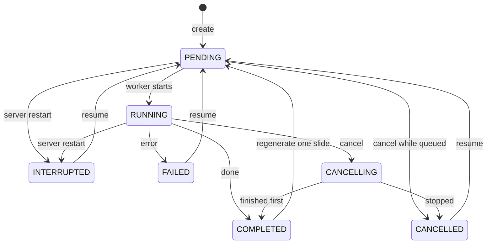

# Presentation jobs: state machine design (JOB-01)

Status: Decision, ready for team review · Date: 28 October 2026 · Wave 2

Unblocks: DB-01, JOB-02, JOB-04, JOB-08 (and through them JOB-03, JOB-05, JOB-06, JOB-07).
Built on: [ARC-01](presentation-architecture.md) (module structure and interfaces).

## 1. Purpose and scope

A presentation is generated by a background job that can take minutes on a local model. The JOB-* tasks add progress, cancel, resume and single-slide regeneration. They all need one shared answer to these questions: **which states exist, which moves are legal, who makes each move, and what may the user do in each state.** This document is that answer.

In scope: statuses, transitions, rules, stages, per-slide states, cancel / restart / resume / regenerate behaviour, the allowed-actions matrix and the HTTP outcomes.
Out of scope (decided by later tasks): the exact JSON shape of `progress` (JOB-02), the code of each transition (JOB-03 to JOB-08), the UI.

## 2. Design in brief

- **Seven statuses.** The four existing ones plus `CANCELLING`, `CANCELLED` and `INTERRUPTED`. Three are **active** (a job owns the row), four are **finished**. `FAILED`, `CANCELLED` and `INTERRUPTED` are **resumable**.
- **Resume reuses the same row.** A resumable row goes back to `PENDING` and the runner continues from saved work. Slide regeneration also goes through `PENDING` and `RUNNING` and returns to `COMPLETED`.
- **The database is the truth.** Status, stage, progress and the cancel flag live in the presentation row. An in-memory cancel event only makes cancellation faster.
- **Every move is a compare-and-set,** so cancel-versus-complete and double-resume races cannot corrupt the row.
- **Partial results are never thrown away** on `FAILED`, `CANCELLED` or `INTERRUPTED`. That is what makes resume cheap.

## 3. Statuses

| Status | Meaning | Kind | Added by |
|---|---|---|---|
| `PENDING` | Row created, resumed, or slide regeneration requested; waiting for the worker | active | exists |
| `RUNNING` | The worker is executing the job | active | exists |
| `CANCELLING` | Cancel requested; the worker has not stopped yet | active | JOB-04 |
| `COMPLETED` | Deck complete and `.pptx` rendered | finished | exists |
| `FAILED` | Stopped by an error; partial results kept | finished, resumable | exists |
| `CANCELLED` | Stopped at the user's request; partial results kept | finished, resumable | JOB-04 |
| `INTERRUPTED` | The server stopped while the job was `PENDING` or `RUNNING`; partial results kept | finished, resumable | JOB-05 |

**Active** means a job owns the row, so nothing else may change it. **Finished** means no job is running. `error` is set only for `FAILED` and `INTERRUPTED`; a `CANCELLED` job has an empty `error`.

## 4. Allowed transitions



| # | From | To | Trigger | Done by | Task |
|---|---|---|---|---|---|
| 1 | (new) | `PENDING` | `POST /notebooks/{id}/presentations` | service | exists |
| 2 | `PENDING` | `RUNNING` | Worker picks the job up | runner | exists |
| 3 | `PENDING` | `CANCELLED` | Cancel while queued | cancel endpoint | JOB-04 |
| 4 | `RUNNING` | `COMPLETED` | All slides written, file rendered | runner | exists |
| 5 | `RUNNING` | `FAILED` | Unhandled error, including Ollama unavailable | runner | exists |
| 6 | `RUNNING` | `CANCELLING` | Cancel requested (`cancel_requested = true`) | cancel endpoint | JOB-04 |
| 7 | `CANCELLING` | `CANCELLED` | Runner sees the flag at a checkpoint, or the LLM call aborts | runner | JOB-04 |
| 8 | `CANCELLING` | `COMPLETED` | Job finished before noticing the flag; nothing left to cancel | runner | JOB-04 |
| 9 | `PENDING`, `RUNNING` | `INTERRUPTED` | Start-up finds a job no worker owns | start-up | JOB-05 |
| 10 | `CANCELLING` | `CANCELLED` | Start-up: the user's intent wins over `INTERRUPTED` | start-up | JOB-05 |
| 11 | `FAILED`, `CANCELLED`, `INTERRUPTED` | `PENDING` | Resume | service | JOB-05 |
| 12 | `COMPLETED` | `PENDING` | Regenerate one slide | service | JOB-06 |
| 13 | `RUNNING` (slide job) | `COMPLETED` | Slide replaced; or regeneration failed or was cancelled and the old slide is kept | runner | JOB-06 |

Any move not in the table is illegal: the API answers **409** (`ConflictError`) and the runner stops without writing. For a slide-regeneration job, rows 5 and 7 are replaced by row 13: it always ends in `COMPLETED`.

## 5. Rules

1. **Compare and set.** Change status with a conditional update (`UPDATE ... WHERE id = ? AND status IN (allowed sources)`) and check that one row changed. If none did, the state moved underneath you: the API returns 409, the runner stops. The helper belongs in `presentation_repo.py` (ARC-05 / JOB-04).
2. **Active is exclusive.** While a row is `PENDING`, `RUNNING` or `CANCELLING` only the runner and the cancel endpoint touch it. Edit, resume, regenerate, restore and delete answer 409.
3. **Partial results survive.** `FAILED`, `CANCELLED` and `INTERRUPTED` keep the outline, the extracted context and every finished slide.
4. **Resume reuses the row.** Same id, no new presentation. The runner skips finished work and never duplicates or reorders slides.
5. **Cancel is not an error.** `GenerationCancelled` is not an `LlmError`, and the slide writer's broad `except Exception` must let it pass (ARC-01 rule 6; GEN-04 narrows it to `LlmError`). A real error that happens while `CANCELLING` still ends `CANCELLED`, and the error text is kept.
6. **Status says what is happening; stage says where.** A finished row keeps the stage where it stopped. Resume sets the stage to `queued` and clears `cancel_requested`.
7. **The database is the truth.** After a restart nothing in memory survives. The in-memory cancel event only speeds up a cancel; `cancel_requested` is the durable copy.
8. **Checkpoints, not interrupts.** The runner checks for cancellation before each stage, between documents, between slides and before rendering. The LLM call itself aborts through the event.
9. **One slide, one state.** Per-slide state is stored in `progress`, not derived from the deck (section 7).

## 6. Stages

| Stage | Today's string | What happens | Saved when finished | Resume starts from |
|---|---|---|---|---|
| `queued` | queued | Waiting for the worker | none | the start |
| `checking_model` | starting | Readiness check of Ollama and the model | none | the start (cheap) |
| `reading_documents` | reading documents | Read the documents; size limit check (CTX-03) | none (rebuilt) | the start of this stage |
| `extracting_context` | (new, CTX-04) | One LLM call per document: summary and facts | each document's result as it finishes (CTX-07) | the first document not yet extracted |
| `outline` | outline | Plan the slides | `outline` (OUT-07) | skipped if saved |
| `writing_slides` | content n/m | Write one slide at a time | each slide as written (JOB-03) | the first slide not done |
| `rendering` | rendering | Draw the `.pptx` | `file_path` | render again only |
| `done` | done | Finished | everything | not resumable |

Until JOB-02, the code keeps writing today's strings (the QA-01 tests assert on them, see ARC-01 section 10). JOB-02 then switches to the stage names above and updates those tests in the same pull request. From then on the `stage` column holds only the name; counts such as "extracting 2/5" or "slide 3/8" live in `progress`.

## 7. Per-slide states

| State | Meaning | On resume |
|---|---|---|
| `pending` | Not started | generate |
| `running` | Being written now (at most one at a time). On cancel or restart it goes back to `pending` | generate |
| `done` | Written and validated; may carry warnings | keep |
| `placeholder` | The model failed after its retries and a minimal fallback slide was inserted | regenerate |
| `failed` | The last (re)generation attempt raised an error; previous content, if any, is kept | retry |

Per-slide state lives in `progress`, as a list indexed by slide number. It cannot be derived from the deck, because a placeholder is only recognisable by a warning sentence. If the team later prefers an `is_placeholder` field on `SlideContent`, that belongs to GEN-04 or JOB-03.

## 8. Cancellation

1. **Request.** The cancel endpoint does a compare-and-set. From `PENDING` it moves straight to `CANCELLED` (the queued job finds the status is no longer `PENDING` and exits). From `RUNNING` it moves to `CANCELLING`, sets `cancel_requested = true` and sets the in-memory cancel event registered for that presentation.
2. **Fast stop.** The streaming LLM call (LLM-03) sees the event and raises `GenerationCancelled` within a second or two, so the worker does not wait for a slow generation to finish.
3. **Checkpoint stop.** Between steps the runner checks the event and the database flag. It saves what is finished, sets `CANCELLED` and keeps the stage where it stopped.
4. **Race.** If the job finishes just as the cancel arrives, the move `CANCELLING` to `COMPLETED` is allowed (row 8). The user gets a finished deck, which is harmless.
5. **Idempotent.** Cancelling a `CANCELLING` job returns the current state without error.

## 9. Restart recovery and resume

**At start-up**, before the worker accepts jobs, one transaction handles every active row: `PENDING` and `RUNNING` become `INTERRUPTED` (stage kept, `error` = "Interrupted by a server restart."), and `CANCELLING` becomes `CANCELLED`, because the user's intent wins. Queued rows become `INTERRUPTED` too, so the user decides whether to resume them. **Automatic resume at start-up is off.**

**Resume** is a compare-and-set from a resumable status to `PENDING` that clears `error` and `cancel_requested`, resets any `running` slide to `pending`, sets the stage to `queued` and submits the job. The runner then uses the saved work as in the "Resume starts from" column of section 6.

## 10. Regenerating one slide

Allowed only from `COMPLETED`. The row goes `COMPLETED`, `PENDING`, `RUNNING` with `progress.kind = "regenerate_slide"`, the runner rewrites just that slide from the saved outline and context, and the row returns to `COMPLETED`. On failure or cancel the old slide is kept, that slide's state becomes `failed`, the message goes in `progress.message`, and the row still returns to `COMPLETED`. The previous version is stored in `slide_versions` so JOB-07 can restore it. The `.pptx` is rendered again after a successful change. While the job runs the row is active, so downloads, edits and other regenerations answer 409.

## 11. What each status allows

| Action | PENDING | RUNNING | CANCELLING | COMPLETED | FAILED | CANCELLED | INTERRUPTED |
|---|---|---|---|---|---|---|---|
| Read status | yes | yes | yes | yes | yes | yes | yes |
| Read deck JSON | 409 (none yet) | partial (JOB-03) | partial (JOB-03) | yes | partial if any | partial if any | partial if any |
| Edit deck (`PUT`) | 409 | 409 | 409 | yes | yes* | yes* | yes* |
| Download `.pptx` | 409 | 409 | 409 | yes | 409 | 409 | 409 |
| Cancel | yes | yes | no-op (200) | 409 | 409 | 409 | 409 |
| Resume | 409 | 409 | 409 | 409 | yes | yes | yes |
| Regenerate slide | 409 | 409 | 409 | yes | 409 | 409 | 409 |
| Restore slide (JOB-07) | 409 | 409 | 409 | yes | 409 | 409 | 409 |
| Delete | yes | 409 | 409 | yes | yes | yes | yes |

\* The edit is allowed and the job becomes `COMPLETED` (see decision B).

### HTTP outcomes

| Endpoint | Allowed from, result | Otherwise |
|---|---|---|
| `POST /presentations/{id}/cancel` | `PENDING`: 200, `CANCELLED`. `RUNNING`: 202, `CANCELLING`. `CANCELLING`: 200, unchanged | 409 |
| `POST /presentations/{id}/resume` | `FAILED`, `CANCELLED`, `INTERRUPTED`: 202, `PENDING` | 409 |
| `POST .../slides/{n}/regenerate` | `COMPLETED`: 202, `PENDING` | 409; 404 if slide `n` does not exist |
| `POST .../slides/{n}/restore` (JOB-07) | `COMPLETED`: 200 | 409; 404 if no stored version |
| `PUT .../deck` | `COMPLETED`, `FAILED`, `CANCELLED`, `INTERRUPTED`: 200, `COMPLETED` | 409 while active |
| `GET .../deck` | any status that has a deck: 200 | 409 if there is no deck yet (as today) |
| `GET .../download` | `COMPLETED`: 200 | 409 (as today) |
| `DELETE .../presentations/{id}` | `PENDING` and finished statuses | 409 while `RUNNING` or `CANCELLING` |

## 12. Where the state lives

| Column | Written by | Holds |
|---|---|---|
| `status`, `stage` | runner, service, start-up | The state machine (sections 3 to 6) |
| `error` | runner, start-up | Message for `FAILED` and `INTERRUPTED`; cleared on resume |
| `progress` (JSON) | runner | Kind, stage detail, current and total, per-slide states, message, start time. JOB-02 fixes the shape |
| `cancel_requested` | cancel endpoint | Durable copy of the cancel request; cleared on resume |
| `context` (JSON) | runner (CTX-07) | Extracted context, saved per document |
| `outline` (JSON) | runner (OUT-07) | The slide plan |
| `deck`, `file_path` | runner, `PUT` deck | Slides as written (partial while running) and the rendered file |
| `slide_versions` (JSON) | runner (JOB-06, JOB-07) | Previous versions of regenerated slides |

Illustrative `progress` while extracting (JOB-02 decides the final shape):

```json
{
  "kind": "generate",
  "stage": "extracting_context",
  "current": 2,
  "total": 5,
  "message": "Extracting facts from document 2 of 5",
  "slides": [],
  "started_at": "2026-10-28T10:02:11"
}
```

## 13. Decisions

These were open points in the proposal.

| | Question | Decision | Reason |
|---|---|---|---|
| A | Does single-slide regeneration go through the status machine? | **Yes.** `COMPLETED`, `PENDING`, `RUNNING`, back to `COMPLETED`, even on failure. The download is unavailable while it runs. | One "active" rule covers every job type, so no second busy flag is needed. |
| B | May a `FAILED`, `CANCELLED` or `INTERRUPTED` deck be edited? | **Yes.** `PUT /deck` is allowed and the job becomes `COMPLETED`. The UI warns that the job can no longer be resumed. | It keeps today's tested behaviour (QA-01 pins it for `FAILED`), and the user is deliberately replacing the deck. |
| C | Partial downloads? | **JSON only.** The partial deck is readable in any status that has one; the `.pptx` only when `COMPLETED`. | A half-built `.pptx` looks finished when it is not. A partial `.pptx` can be added later. |
| D | Delete while a job is active? | **409 while `RUNNING` or `CANCELLING`.** `PENDING` deletes immediately. The UI does cancel, then delete. | Avoids the worker writing to a deleted row and orphan files. |
| E | Resume automatically after a restart? | **No.** `INTERRUPTED` rows wait for the user. | A restart should not silently spend minutes of CPU. |

## 14. What the later tasks take from this

| Task | Uses |
|---|---|
| DB-01 | The status names and the new columns (`outline`, `context`, `progress`, `cancel_requested`, `slide_versions`). |
| JOB-02 | The stage list (section 6) and per-slide states (section 7); decides the exact shape of `progress`, including "extracting 2/5". |
| JOB-03 | Which stage saves what; saves each slide as it is written so a partial deck can be read and resumed. |
| JOB-04 | Transitions 3, 6, 7, 8; the cancel flag and event registry; adds `CANCELLING` to the `update_deck` guard. |
| JOB-05 | Transitions 9 to 11; the resume point per stage; replaces `fail_interrupted_jobs`. |
| JOB-06 | Transitions 12 and 13; regeneration through `PENDING` and `RUNNING` back to `COMPLETED`. |
| JOB-08 | Rules 1 and 2, the delete row of section 11, and the 409 messages. |
